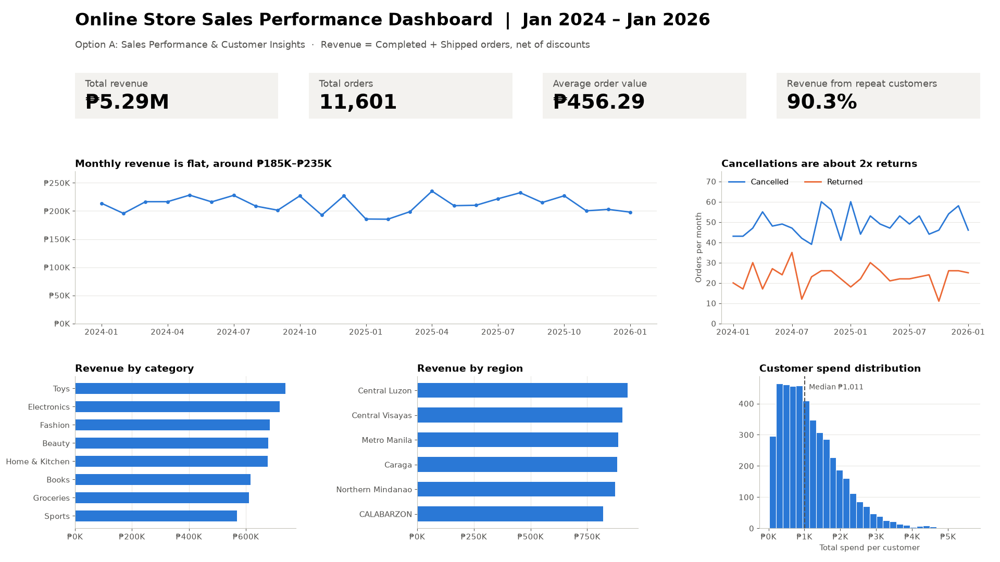
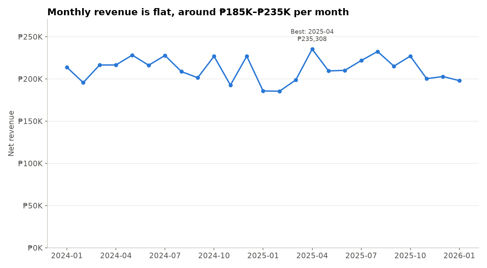
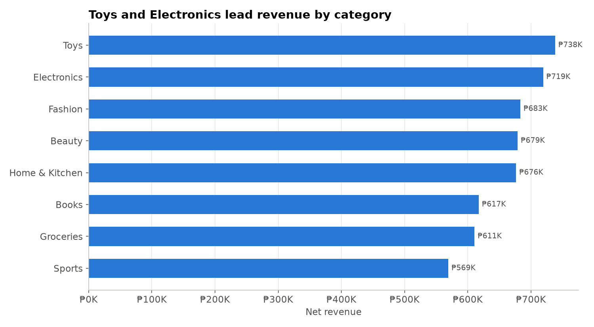
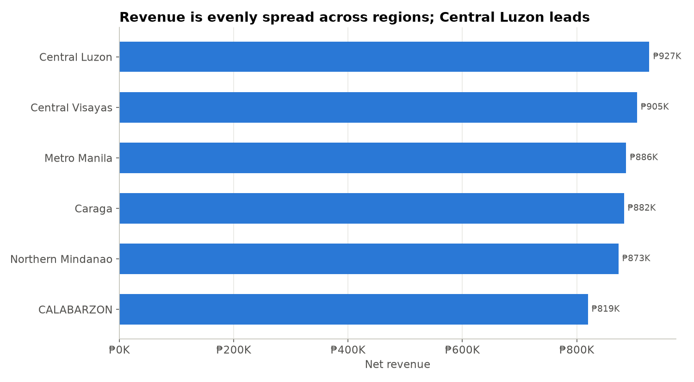
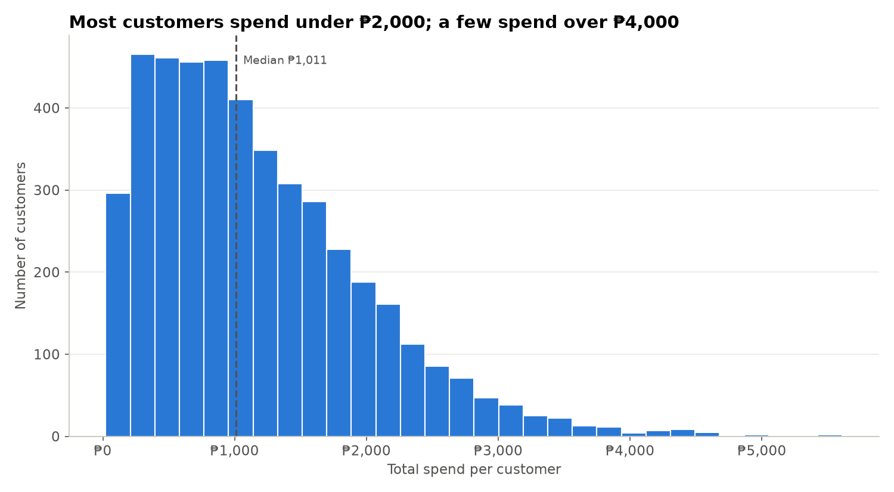
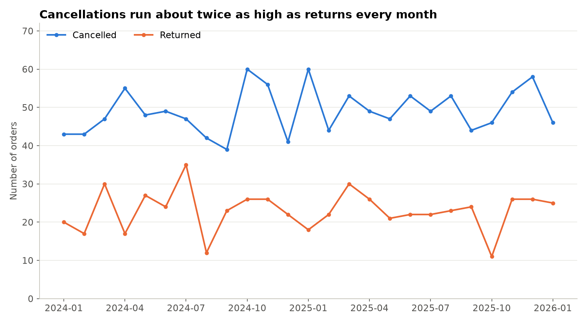

# Online Store Sales Performance & Customer Insights — Python Capstone

**Python Programming Data Analyst Professional Certificate · DataSense Analytics**
**Option A: Sales Performance & Customer Insights** · Kara Quinn Beverly · November 2026

> Business question: **"How is the store performing, and what drives revenue?"**



---

## Executive Summary

- Analysed 25 months of online store sales (Jan 2024 – Jan 2026) after cleaning 7 raw CSV files.
- Fixed 23 data-quality issues: duplicates, inconsistent labels, mixed date formats, ₱ prices stored as text, invalid values and orphan records.
- Built one fact table of 36,892 order items (orders + items + products + customers).
- Total revenue (Completed + Shipped, net of discounts): **₱5.29M** from **11,601** orders; AOV **₱456.29**.
- Monthly revenue was flat at about ₱185K–₱235K; 2025 was about 2% lower than 2024.
- Categories are balanced: Toys leads (13.9%), Sports is lowest (10.8%).
- Regions are balanced: Central Luzon leads (17.5%); Metro Manila ranks only 3rd.
- The top 10 products are only 4.0% of revenue — no reliance on a few bestsellers.
- Repeat customers (74.8% of customers) generate **90.3%** of revenue and spend about 3x more than one-time buyers.
- 8.2% of orders are cancelled and 3.9% returned — about ₱818K in lost sales.
- Recommendations: invest in customer retention and reduce cancellations.

Full version: [`Executive_Summary.txt`](Executive_Summary.txt) · One-page insights: [`One_Page_Insights_Summary.md`](One_Page_Insights_Summary.md) · Full report: [`DASP - B04 - Kara Quinn Beverly.pdf`](DASP%20-%20B04%20-%20Kara%20Quinn%20Beverly.pdf)

---

## Repository Contents

| File / folder | What it is |
|---|---|
| `Kara_Beverly_Python_Capstone.ipynb` | Jupyter notebook with all code: loading, cleaning, fact table, KPIs, charts, dashboard |
| `Executive_Summary.txt` | Executive summary (11 bullet lines) |
| `One_Page_Insights_Summary.md` | One-page summary of insights and recommendations |
| `cleaning_log.csv` | All 23 cleaning fixes, with the rule used and rows affected |
| `cleaned_data/Cleaned_customers.csv` | 5,000 cleaned customers |
| `cleaned_data/Cleaned_products.csv` | 800 cleaned products |
| `cleaned_data/Cleaned_orders.csv` | 14,957 cleaned orders |
| `cleaned_data/Cleaned_order_items.csv` | 36,892 cleaned order items |
| `cleaned_data/Fact_sales.csv` | Joined fact table used for all analysis |
| `charts/` | Dashboard (1920×1080) and 5 exported chart PNGs |
| `*.csv` (root) + `README_DATA_DICTIONARY.txt` | Original raw training dataset (synthetic, provided by DataSense Analytics) |

---

## Method

1. **Load** all 7 CSVs with pandas; inspect with `.head()`, `.info()`, duplicate and null counts.
2. **Clean** each issue with a *check → fix → re-check* pattern, logging every fix:
   - standardized 18 category labels into 8 categories and gender into Male/Female/Unknown
   - handled nulls with explicit fill/drop rules (e.g. discount → 0, shipping fee → median, item price → backfilled from products)
   - removed duplicates (duplicate = repeated `customer_id` / `order_id` / `order_item_id`)
   - parsed 3 mixed date formats in signup and order dates
   - converted `₱1,234.56`-style text prices to numbers
   - validated join keys and removed orphan records (placeholder IDs `CUST999999`, `PROD00000`)
3. **Build a fact table** with left joins (`.merge()`), validating that row counts did not change.
4. **Compute KPIs** with `.groupby()` / `.agg()`.
5. **Visualize** with matplotlib: 5 charts + a 1920×1080 dashboard.

**Revenue definition:** `quantity × unit_price_at_purchase × (1 − discount_pct)`, counting only **Completed** and **Shipped** orders. Cancelled and Returned orders earned no revenue; Pending orders are not yet confirmed.

---

## KPI Results

| KPI | Result |
|---|---|
| Total revenue | ₱5,293,430 |
| Total orders | 11,601 |
| Average order value | ₱456.29 |
| Best / worst month | Apr 2025 (₱235K) / Feb 2025 (₱185K) |
| Top category | Toys — ₱738K (13.9%) |
| Top region / city | Central Luzon (17.5%) / Olongapo (₱341K) |
| Top product | KidJoy Toys 607 — ₱27,352 |
| Repeat customers | 74.8% of customers → 90.3% of revenue |

---

## Charts

| | |
|---|---|
|  |  |
|  |  |
|  | |

---

## Key Insights

1. **Loyal customers drive revenue** — repeat buyers spend about ₱1,415 each vs ₱449 for one-time buyers.
2. **Growth has stalled** — revenue has been flat for 2 years; with a stable AOV, growth must come from more orders.
3. **Cancellations are the biggest leak** — about 49 cancelled orders per month (2x returns), worth about ₱541K.
4. **Revenue is diversified** — no category, region or product dominates.
5. **Metro Manila under-performs** — only 3rd, and none of its cities reach the top 10.
6. **CALABARZON needs attention** — lowest revenue share and lowest AOV.
7. **Cleaning mattered** — without it, Electronics would be split across 4 labels and 2,203 sales would have no price.

## Recommendations

1. **Invest in retention:** loyalty rewards for 2nd/3rd purchases and win-back offers for the 1,141 one-time customers.
2. **Reduce cancellations:** investigate causes (stock, payment, delivery) and target a cut from 8.2% to 6%.

---

## How to Run

```bash
py -m pip install notebook pandas matplotlib seaborn
py -m notebook
```
Open `Kara_Beverly_Python_Capstone.ipynb` and choose **Run → Run All Cells**. The raw CSVs must be in the same folder as the notebook.

**Tools:** Python 3.13 · Jupyter Notebook · pandas · NumPy · matplotlib
